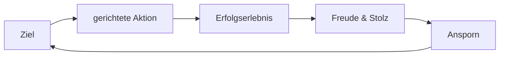
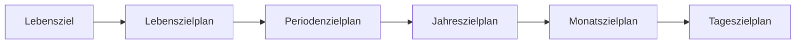

# Zielmanagement
## Positiver Kreislauf

## Negativer Kreislauf

## Zielstruktur
- Messbare Ziele: *Wer? Was? Wie viel? Wo? Wann? Warum?*
- Machbare Ziele: *Herausfordernd*, aber nicht *unmöglich*.
- *Tipp:* Positive Zielformulierung & Ziele schriftlich festhalten.
- *SMART* - *Spezifisch (definiert)*; *Messbar*; *Aktivierend (motivierend)*; *Realistisch*; *Terminierbar (fixer Zeitraum)*.
# Zielplanung

- 
