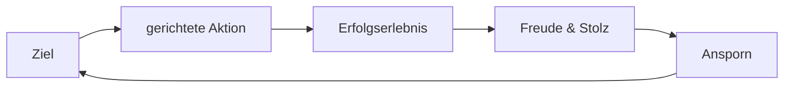
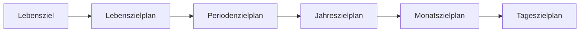

# Zielmanagement
## Positiver Kreislauf

## Negativer Kreislauf

## Zielstruktur
- Messbare Ziele: *Wer? Was? Wie viel? Wo? Wann? Warum?*
- Machbare Ziele: *Herausfordernd*, aber nicht *unmöglich*.
- *Tipp:* Positive Zielformulierung & Ziele schriftlich festhalten.
- *SMART* - *Spezifisch (definiert)*; *Messbar*; *Aktivierend (motivierend)*; *Realistisch*; *Terminierbar (fixer Zeitraum)*.
## Zielplanung

- *80-20-Regel:* 20% der Arbeitszeit bringt 80% der Ergebnisse.
- *Effizient* sein: "Die Dinge richtig tun".
	- Gutes Ergebnis in geplanter Zeit.
	- Optimierung der Arbeitsschritte.
- *Effektiv* sein: "Die richtigen Dinge tun".
	- Direktester Weg zum Ziel.
	- Auf Aufgaben konzentrieren, die die größten Erfolge bringen.
### Eisenhower-Prinzip
![[Pasted image 20261017234548.png|415]]
- *A,B,C,(D)*-Aufgaben.
- *Wichtigkeit* vor *Dringlichkeit*.
- Zuerst A-Aufgaben, aber jeden Tag eine langfristige B-Aufgabe.
- *Goldene Regel:* **Nein**, wenn möglich. **Ja**, wenn nötig.
- *Druck/Defizite:* Arbeit, Familie & Freunde, Körper, Gesundheit, Psychische Belastung, Finanzen.
- *Balance* von Lebensrollen finden.
	- Ein Lebensziel für jede Rolle.
	- Warum Ziele überhaupt? Motivation?
	- *Burnout:* dauerhafte "seelische Müdigkeit".
	- Auszeiten planen & Energie tanken.
# Zeitplanung
- *Planung:* Immer mit Termin; Schriftlich; Notieren aller Aktivitäten, Aufgaben & Termine.
- *60-40-Regel:* 60% Zeit für Aufgaben, 40% für Verzögerung und Unerwartetes.
- Identifikation von *Zeitfressern*:
	- Fehlende Ziele & Prioritäten.
	- Alles auf einmal machen.
	- Schwer Nein-Sagen.
	- Fehlende Infos.
	- Perfektionismus.
	- Falsche Zeiteinschätzung.
- *Bündeln* gleichartiger Aufgaben.
- *Störfreie Zeit* planen.
- *Tagesplanung:*
	- Frühaufsteher/Abendmenschen sind meist Morgens/Abends produktiv.
	- Tagesplan (dauert ~10 Minuten).
	- To-Do-Liste, Liste kleiner Aufgaben bei Leerlauf erledigen.
	- Neue Aufgaben zu neuer To-Do-Liste.
- *Wochenplanung:* Mehr Freiraum für Aufgabenverteilung; Mehr Platz für Pufferzeit; Überschaubar.
- *"Kiesel-Prinzip":* Zuerst große Aufgaben, dann kleine Aufgaben.
- Für jede Lebensrolle eine *B-Aufgabe*, die jeden Tag *90 Minuten* gewidmet wird.
- *Planungssysteme:*
	- *To-Do-Listen:*
		- Gut für tägliche oder wöchentliche Aufgabenplanung.
		- Schlecht für Termine, langfristige Planung.
	- *Kalender:*
		- Unerläßlich für Terminplanung.
		- Meist kein Platz für Aufgaben.
	- *Zeitplaner:*
		- Mit integriertem Kalender & To-Do-Liste.
		- Möglicherweise teuer.
# Tagesgestaltung
- *Aufschieben* von Aufgaben:
	- Warum aufschieben?
	- Teilziele & Teilschritte planen.
	- Belohnung für schwere Aufgaben.
- *Besprechungen (1:1):*
	- In Blöcke Fassen.
	- Vorher kurze Ziele, Fragen, etc. notieren.
	- Immer Notizen machen.
	- Planung von Zeiten ohne telefonische Erreichbarkeit.
- *Meetings (mehrere Personen):*
	- *Tagesordnung* planen.
	- Ziele festlegen & Ergebnis planen.
	- Teilnehmer vorbereiten & vorbereiten lassen.
	- *Moderator* für Redezeit & Feedback & *Protokollant* festlegen.
	- Fragen & Zwischenergebnisse visualisieren.
	- *Pause* bei langen Besprechungen.
	- Protokoll kurz und knapp: Wer? Was? Wann?
	- Wer muss wirklich am Meeting teilnehmen? Müssen alle immer anwesend sein?
	- Ausweichen von *nicht-konstruktiven* Punkten.
	- *Protokoll* an alle vergeben.
- *Emails* nur mit Prof. und nicht Prof. Dr. & Anhänge < 20 MB.