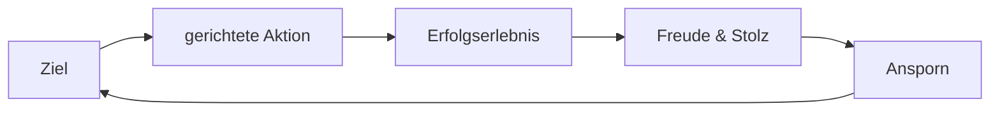

# Zielmanagement
## Positiver Kreislauf

## Negativer Kreislauf

## Zielstruktur
- Messbare Ziele: *Wer? Was? Wie viel? Wo? Wann? Warum?*
- Machbare Ziele: *Herausfordernd*, aber nicht *unmöglich*.
- *Tipp:* Positive Zielformulierung & Ziele schriftlich festhalten.
- *SMART* - *Spezifisch (definiert)*; *Messbar*; *Aktivierend (motivierend)*; *Realistisch*; *Terminierbar (fixer Zeitraum)*.
## Zielplanung

- *80-20-Regel:* 20% der Arbeitszeit bringt 80% der Ergebnisse.
- *Effizient* sein: "Die Dinge richtig tun".
	- Gutes Ergebnis in geplanter Zeit.
	- Optimierung der Arbeitsschritte.
- *Effektiv* sein: "Die richtigen Dinge tun".
	- Direktester Weg zum Ziel.
	- Auf Aufgaben konzentrieren, die die größten Erfolge bringen.
### Eisenhower-Prinzip
![[Pasted image 20261017234548.png|415]]
- *A,B,C,(D)*-Aufgaben.
- *Wichtigkeit* vor *Dringlichkeit*.
- Zuerst A-Aufgaben, aber jeden Tag eine langfristige B-Aufgabe.
- *Goldene Regel:* **Nein**, wenn möglich. **Ja**, wenn nötig.
- *Druck/Defizite:* Arbeit, Familie & Freunde, Körper, Gesundheit, Psychische Belastung, Finanzen.
- *Balance* von Lebensrollen finden.
	- Ein Lebensziel für jede Rolle.
	- Warum Ziele überhaupt? Motivation?
	- *Burnout:* dauerhafte "seelische Müdigkeit".
	- Auszeiten planen & Energie tanken.
# Zeitplanung
