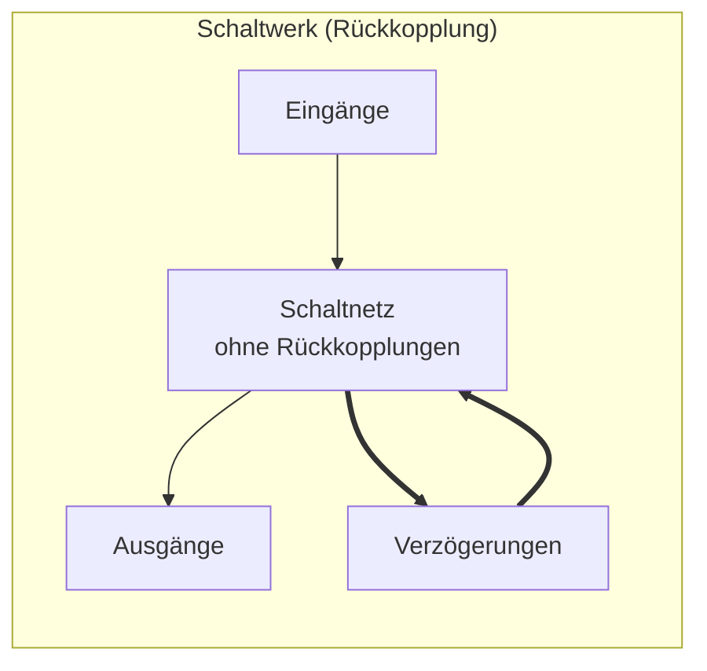

# Automatisierte Verarbeitung

- Schaltwerk mit *Ein-* und *Ausgabedaten* formalisieren.
- Eingabedaten und Ausgabedaten sind *Nachrichten* => *Alphabet Sequenz*.
- Rückkopplung über *lokales Gedächtnis* => *Variablen*.
# Definition
## Automat ohne Ausgabe
- *Ein deterministischer Automat ohne Ausgabe ist ein Tripel $(Q,\Sigma,\delta)$.*
	- $Q = \{q_{0},q_{1},q_{2}\}$ - Menge von *Zuständen*.
	- $\Sigma = \{\sigma_{0},\sigma_{1},\sigma_{2}\}$ - Menge von *Eingabezeichen*.
	- $\delta: Q \times \Sigma \to Q$ - *Übergangsfunktion*.
- $Q$ und $\Sigma$ sind *abzählbar*.
- $\delta$ ordnet jedem Paar aus *Zustand* & *Eingabezeichen* einen *Folgezeichen* zu.
	- D.h. wenn in einem Zustand $q_{i}$ das Eingabezeichen $\sigma_{i}$ auftritt, dann wechsel in den Zustand $\delta(q_{i},\sigma_{i}) = q_{k}$.
	- Eingabezeichen $\sigma_{i}$ wird *konsumiert*.
- $\delta$ ist eine Funktion => Ordnet jedem Paar einen Folgezustand *eindeutig* zu.
	- -> *Deterministischer Automat*-
### Beispiel: Getränkeautomat
- Getränk für *1,5€*.
- $Q = \{0, 50, 100\}$
- $\Sigma = \{50\textcent, 1\texteuro\}$
- $\delta(q, \sigma)$:
	- $\delta(0, 50\textcent) = 50;\quad \delta(0, 1\texteuro) = 100$
	- $\delta(50, 50\textcent) = 100;\quad \delta(50, 1\texteuro) = 0$
	- $\delta(100, 50\textcent) = 0; \quad \delta(100, 1\texteuro) = 0$
- *Alternative:* $\delta(100,1\texteuro) = 50$
## Automat mit Ausgabe
- Ein *deterministischer* Automat mit Ausgabe ist ein Tupel $(Q,\Sigma,\delta,Y,g)$:
	- $Q, \Sigma, \delta$ definieren Automaten *ohne Ausgabe*.
	- $Y = \{y_{0},y_{1},y_{2},\dots\}$ definiert eine Menge von *Ausgabezeichen*.
		- Falls Ausgabe ignoriert werden soll:
			- Extra Zeichen (bspw. "pling").
			- Sonst: $\epsilon$: "empty"
	- $g: Q \times \Sigma \to Y$ definiert eine *Ausgabefunktion*.
### Beispiel: Getränkeautomat
- Getränk für *1,5€*.
- $\Sigma=\{50\textcent,1\texteuro\}$
- $Q=\{0,50,100\}$
- $Y=\{\text{pling, getränk, getränk+50\textcent}\}$
- $\delta(q,\sigma)$:
	- $\delta(0,50\textcent)=50; \quad \delta(0,1\texteuro)=100$
	- $\delta(50,50\textcent)=100; \quad \delta(50,1\texteuro)=0$
	- $\delta(100,50\textcent)=0; \quad \delta(100,1\texteuro)=0$
- $g(q,\sigma)$:
	- $g(0,50\textcent)=\text{pling}; \quad g(0,1\texteuro)=\text{pling}$
	- $g(50,50\textcent)=\text{pling}; \quad g(50,1\texteuro)=\text{getränk}$
	- $g(100,50\textcent)=\text{getränk}; \quad g(100,1\texteuro)=\text{getränk+50\textcent}$
## Endlicher Automat
=> Ein Automat ist endlich, wenn die Menge der *Zustände*, der *Eingabezeichen* und der *Ausgabezeichen* *endlich* ist.
## Nichtdeterministischer Automat
- Ein Automat ist *nichtdeterministisch*, wenn:
	- $\delta \subseteq (Q \times \Sigma \times Q)$ eine *Relation* ist bzw:
		- $\delta: Q \times \Sigma \to \mathbb{P}(Q)$ eine Funktion in die Menge aller *Teilmengen* von $Q$ ist.
	- $q \subseteq (Q \times \Sigma \times Y)$ eine *Relation* ist, bzw.
		- $g: Q \times \Sigma \to \mathbb{P}(Y)$ eine Funktion in die Menge aller *Teilmengen* von $Y$ ist.
- Automat darf *frei* aus den möglichen *Folgezuständen* und *Ausgangszeichen* wählen.
	- *Alternativ:* Automat durchläuft alle Folgezustände *parallel*.
- Jeder *deterministischer* Automat ist trivial ein *nichtdeterministischer* Automat.
- Jeder *nichtdeterministischer* Automat kann in einen deterministischen transformiert werden.
- *NEA* = nichtdeterministischer, endlicher Automat.
- *DEA* = deterministischer, endlicher Automat.
## Eingabe
- Bei *nichtdeterministischen* Automaten möchte man manchmal Zustandsänderung *ohne* Eingabe.
- Wie bei der Ausgabe: $\epsilon$ "empty".
## Anfang & Ende
- Mit welchem Zustand *beginnt* ein DEA/NEA?
- *Wann* hört ein Automat auf?
- *Deterministischer* Automat mit Anfang und Ende ist ein Tupel $(Q,\Sigma,\delta,Y,g,q_{s},F)$ wobei:
	- $q_{s}$ der Anfangszustand ist.
	- $F$ eine Teilmenge von $Q$ die Menge der Endzustände ist.