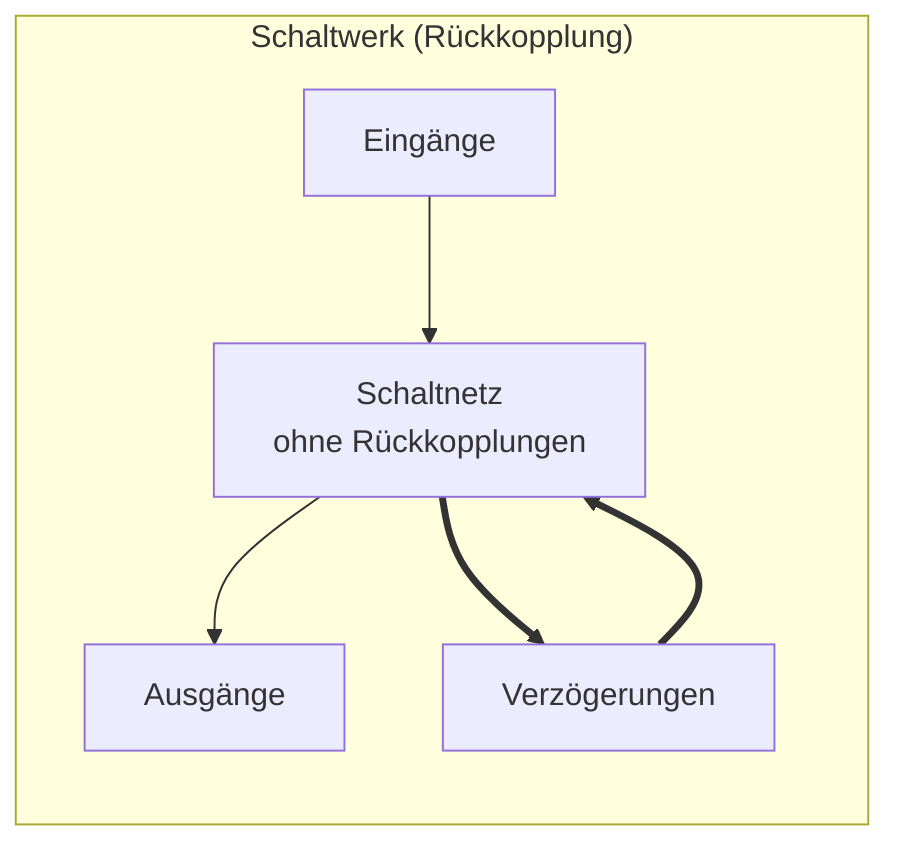

# Automatisierte Verarbeitung

- Schaltwerk mit *Ein-* und *Ausgabedaten* formalisieren.
- Eingabedaten und Ausgabedaten sind *Nachrichten* => *Alphabet Sequenz*.
- Rückkopplung über *lokales Gedächtnis* => *Variablen*.
# Automat ohne Ausgabe
- *Ein deterministischer Automat ohne Ausgabe ist ein Tripel $(Q,\Sigma,\delta)$.*
	- $Q = \{q_{0},q_{1},q_{2}\}$ - Menge von *Zuständen*.
	- $\Sigma = \{\sigma_{0},\sigma_{1},\sigma_{2}\}$ - Menge von *Eingabezeichen*.
	- $\delta: Q \times \Sigma \to Q$ - *Übergangsfunktion*.
- $Q$ und $\Sigma$ sind *abzählbar*.
- $\delta$ ordnet jedem Paar aus *Zustand* & *Eingabezeichen* einen *Folgezeichen* zu.
	- D.h. wenn in einem Zustand $q_{i}$ das Eingabezeichen $\sigma_{i}$ auftritt, dann wechsel in den Zustand $\delta(q_{i},\sigma_{i}) = q_{k}$.
	- Eingabezeichen $\sigma_{i}$ wird *konsumiert*.
- $\delta$ ist eine Funktion => Ordnet jedem Paar einen Folgezustand *eindeutig* zu.
	- -> *Deterministischer Automat*-
## Beispiel: Getränkeautomat
- Getränk für *1,5€*.
- $Q = \{0, 50, 100\}$
- $\Sigma = \{50\textcent, 1\texteuro\}$
- $\delta(q, \sigma)$:
	- $\delta(0, 50\textcent) = 50;\quad \delta(0, 1\texteuro) = 100$
	- $\delta(50, 50\textcent) = 100;\quad \delta(50, 1\texteuro) = 0$
	- $\delta(100, 50\textcent) = 0; \quad \delta(100, 1\texteuro) = 0$
- *Alternative:* $\delta(100,1\texteuro) = 50$
# Automat mit Ausgabe
- Ein *deterministischer* Automat mit Ausgabe ist ein Tupel $(Q,\Sigma,\delta,Y,g)$:
	- $Q, \Sigma, \delta$ definieren Automaten *ohne Ausgabe*.
	- $Y = \{y_{0},y_{1},y_{2},\dots\}$ definiert eine Menge von *Ausgabezeichen*.
		- Falls Ausgabe ignoriert werden soll:
			- Extra Zeichen (bspw. "pling").
			- Sonst: $\epsilon$: "empty"
	- $g: Q \times \Sigma \to Y$ definiert eine *Ausgabefunktion*.
## Beispiel: Getränkeautomat
- Getränk für *1,5€*.
- $\Sigma=\{50\textcent,1\texteuro\}$
- $Q=\{0,50,100\}$
- $Y=\{\text{pling, getränk, getränk+50\textcent}\}$
- $\delta(q,\sigma)$:
	- $\delta(0,50\textcent)=50; \quad \delta(0,1\texteuro)=100$
	- $\delta(50,50\textcent)=100; \quad \delta(50,1\texteuro)=0$
	- $\delta(100,50\textcent)=0; \quad \delta(100,1\texteuro)=0$
- $g(q,\sigma)$:
	- $g(0,50\textcent)=\text{pling}; \quad g(0,1\texteuro)=\text{pling}$
	- $g(50,50\textcent)=\text{pling}; \quad g(50,1\texteuro)=\text{getränk}$
	- $g(100,50\textcent)=\text{getränk}; \quad g(100,1\texteuro)=\text{getränk+50\textcent}$
# Endlicher Automat
=> Ein Automat ist endlich, wenn die Menge der *Zustände*, der *Eingabezeichen* und der *Ausgabezeichen* *endlich* ist.
# Nichtdeterministischer Automat
- Ein Automat ist *nichtdeterministisch*, wenn:
	- $\delta \subseteq (Q \times \Sigma \times Q)$ eine *Relation* ist bzw:
		- $\delta: Q \times \Sigma \to \mathbb{P}(Q)$ eine Funktion in die Menge aller *Teilmengen* von $Q$ ist.
	- $q \subseteq (Q \times \Sigma \times Y)$ eine *Relation* ist, bzw.
		- $g: Q \times \Sigma \to \mathbb{P}(Y)$ eine Funktion in die Menge aller *Teilmengen* von $Y$ ist.
- Automat darf *frei* aus den möglichen *Folgezuständen* und *Ausgangszeichen* wählen.
	- *Alternativ:* Automat durchläuft alle Folgezustände *parallel*.
- Jeder *deterministischer* Automat ist trivial ein *nichtdeterministischer* Automat.
- Jeder *nichtdeterministischer* Automat kann in einen deterministischen transformiert werden.
- *NEA* = nichtdeterministischer, endlicher Automat.
- *DEA* = deterministischer, endlicher Automat.
## Eingabe
- Bei *nichtdeterministischen* Automaten möchte man manchmal Zustandsänderung *ohne* Eingabe.
- Wie bei der Ausgabe: $\epsilon$ "empty".
## Anfang & Ende
- Mit welchem Zustand *beginnt* ein DEA/NEA?
- *Wann* hört ein Automat auf?
- *Deterministischer* Automat mit Anfang und Ende ist ein Tupel $(Q,\Sigma,\delta,Y,g,q_{s},F)$ wobei:
	- $q_{s}$ der *Anfangszustand* ist.
	- $F$ eine *Teilmenge* von $Q$ die Menge der *Endzustände* ist.
- Man kann auch für *nichtdeterministische* Automaten den Anfang in Form einer *Teilmenge* von $Q$ definieren.
- Beim Endzustand hört der Automat *auf*, sofern *kein* Eingabezeichen mehr verarbeitet werden kann.
# Zwischenstand
- Automaten sind *Abstraktionen* von Computern.
- Automaten sind ein *Modell* von realen Computern.
- *Offen:* Was können wir mit diesem Modell anfangen?
- *Offen:* Reicht dieses Modell aus?
# Nachrichtenverarbeitung
## Nachrichten
- Eine Nachricht ist eine aus den *Zeichen* eines *Alphabets* gebildete *Zeichenfolge*.
- Ein Automat $(Q,\Sigma,\delta,Y,g,z_{s},E)$ besitzt ein *Eingabealphabet*.
- Wenn unsere Nachricht aus Zeichen von $\Sigma$ besteht, *welche* Nachrichten akzeptiert der Automat?
### Beispiel
- $\Sigma = \{0,1\}$
- $Q=\{a,b\}; \quad q_{s}=a; \quad E = \{b\}$
- $\delta(a,0)=a; \quad \delta(a,1)=b$
-> Jede Nachricht, die beliebig viele $0$ hat und dann mit einer $1$ endet.
### Beispiel 2
- $\Sigma=\{0,1\}$
- $Q=\{a,b,c,d,e,f\}; \quad z_{s}=a; \quad E=\{d,e,f\}$
- $\delta(a,0)=b; \quad \delta(a,1)=c$
- $\delta(b,0)=d; \quad \delta(b,1)=e$
- $\delta(c,0)=e; \quad \delta(c,1)=f$
- Jede Nachricht aus zwei Zeichen.
- Wenn $Y=\{0,1,2\}$ und $g(d)=0$, $g(f)=2$, $g(a)=g(b)=g(c)=\epsilon$.
	- Ausgabe der Summe der beiden Ziffern.
## Fangzustand
- Ist der Automat im Endzustand, dann hat er eine Nachricht erfolgreich gelesen.
- *Problem:* Fehler-Erkennung:
	- *Lösung:* Separater Zustand, analog Endzustand.
	- *Lösung:* Zustand in dem der Automat gefangen bleibt.
=> *Ein Fangzustand $x$ ist ein Zustand aus $Q$, für den gilt: $\delta(x,\sigma) = x$ für alle $\sigma \in \mathbb{Z}$*.
## Erkennung von Nachrichten
- Sei $m=\{m_{0},m_{1},\dots,m_{n-1}\}$ eine Nachricht der Länge $n$ aus $\Sigma^*$, d.h. $m_{i} \in \Sigma$ für alle ($0 \leq i \leq n$).
	- $|m|=n$ bezeichnet die Länge einer *beliebigen* Nachricht $m$.
- Sei $A=(Q,\Sigma,q_{s},F)$ ein Automat mit *Anfangszustand* $q_{s}$ und einer *Menge* $F$ von *Endzuständen*.
- Sei $\delta(m)=\delta(\delta_{i-1}(m),m_{i})$ für $0<i<n$ und $\delta_{0}(m)=\delta(q_{s},m_{0})$
- Wenn $\delta_{n}(m) \in F$ ist, dann hat der Automat $A$ die Nachricht $m$ *akzeptiert*.
	- $\delta_{n}(m)=\delta_{|m|}(m)$
## Akzeptierte Sprachen
- Eine Sprache ist eine Teilmenge von $\Sigma^*$.
- Sei $A = (Q,\Sigma,\delta,q_{s},F)$ ein Automat.
- Die akzeptierte Sprache des Automaten $A$ wird als $L(A)$ bezeichnet.
- $L(A)=\{m \in \Sigma^* \quad | \quad \delta_{|m|}(m) \in F\}$
- Automaten erkennen, ob ein Wort $w \in \Sigma^*$ zur Sprache $L$ des Automaten gehört.
- Mithilfe eines *Ausgabealphabets* können Zeichenfolgen in andere übersetzt werden.
# Komplexere Sprachen
- Endliche Automaten können nur *"einfache"* Sprachen erkennen.
- Komplexe Sprachen benötigen einen beliebig großen Zwischenspeicher.
## Stapelspeicher
- Auch: *Kellerspeicher* oder englisch *Stack*.
- Operation `push` legt ein Element *auf* den Stapel.
- Operation `pop` *nimmt* das oberste Element vom Stapel.
- Stapel kann beliebig hoch, d.h. beliebig viele Element enthalten.
## Kellerautomaten
- Erweiterung der endlichen Automaten um einen *Kellerspeicher*.
- Zustandsänderung nur durch Zustand, Eingabe und oberstes Kellerelement.
- Falls Keller leer => *spezielles* Zeichen wird gesendet.
- Definiert als $(Q,\Sigma,\Gamma,\delta,q_{s},\#)$:
	- $Q = \{q_{0},q_{1},\dots\}$ eine endliche Menge von Zuständen.
	- $\Sigma=\{\sigma_{0},\sigma_{1},\dots\}$ ein Eingabealphabet.
	- $\Gamma=\{\gamma_{0},\gamma_{1},\dots\}$ ein Kelleralphabet.
	- $q_{s} \in Q$ ein Startzustand.
	- $\# \in \Gamma$ das unterste Kellersymbol.
	- $\delta: Q \times (\Sigma \cup \{\epsilon\}) \times \Gamma \to \mathbb{P}(Q \times \Gamma^*)$ eine Übergangsfunktion, wobei nur auf endliche Teilmengen von $Q \times \Gamma^*$ abgebildet wird.
### Kellersprachen
- Alle Sprachen, die von *endlichen* Automaten erkannt werden.
- Beispiel:
	- Sei $\Sigma=\{a,b\}$. Erstelle einen Automaten, der die Sprache `a..ab..b` erkennt, wobei die Folgen `a..a` und `b..b` gleich lang sein müssen.
		-> Für jedes `a` wird ein `x` im Keller gespeichert. Sobald `b` erkannt wird, muss solange vom Keller gelesen werden, bis `#` erkannt wird.
## Turing-Maschine
Eine *deterministische* Turing-Maschine besteht aus:
- Einem endlichen *Eingabealphabet* $\Sigma$.
- Einem endlichen *Bandalphabet* $\Gamma$ mit $\Sigma \subseteq \Gamma$.
- Einem unbegrenzten *Schreib-/Leseband*, das initial mit Werten von $\Gamma$ beschrieben ist.
- Einem längs des Bandes nach *links* (L) und *rechts* (R) um jeweils einen Schritt beweglichen *Schreib-/Lesekopf*.
- Einer *endlichen* Menge von Zuständen $Q$ mit einem *Anfangszustand* und mindestens einem *Endzustand* (Haltezustand).
- Einer Zustandsübergangsfunktion $\delta: Q \times \Gamma \to Q \times \Gamma \{L,R\}$.
- **Bemerkung:**
	- Wir verzichten auf unterschiedliche Eingabe- und Bandalphabete.
	- Man kann sich auf $\Sigma=\{0,1\}$ beschränken.
	- *Konfiguration* = Anordnung der Zeichen auf dem Band + Kopfposition.
### Berechenbarkeit
=> Eine Funktion $y = f(x)$ mit $x,y \in \Sigma^*$ heißt *Turing-berechenbar*, wenn es eine Turing-Maschine mit Folgen von *Zustandsänderungen* gilt.
- Wenn die Funktion nur *partiell* ist, dann muss die Turing-Maschine *nicht anhalten*.
	- Beispiel: $\log(x)$ mit $x = 0$.
	- *These:* jede mathematische Funktion ist Turing-berechenbar.
		=> **Church-Turing-These:** *"Die Klasse der Turing-berechenbaren Funktionen stimmt mit der Klasse der intuitiv berechenbaren Funktionen überein".*
### Simulation
- Die *Konfiguration* einer Turing-Maschine lässt sich als *Zahl* darstellen.
	- Zustände, aktueller Zustand, Bandinhalte und Position des Kopfes.
	- Analog den Stellen in einer *Dezimalzahl*.
- Jede einzelne *Zustandsübergang* überführt eine *Konfiguration* in die nächste.
- Wenn man die *Konfiguration* auf dem Band einer *anderen* Turing-Maschine speichert, dann kann diese die ursprüngliche *simulieren*.
=> Möglichkeit einer *universellen* Turing-Maschine, die *alle* anderen Turing-Maschinen simulieren kann.
### Brainfuck
- Praktische Anwendung einer Turing-Maschine.
- Implementiert Turing-Maschine mit 8 Befehlen.
## Formale Sprachen
- Eine Teilmenge $L \subseteq \Sigma^*$ heißt *formale Sprache* über einem *endlichen* Alphabet $\Sigma$.
- $\Sigma^*$ bezeichnet man als *Kleenesche Hülle* des Alphabets.
	- D.h. eine Menge aller Wörter beliebiger Länge.
- Soll das leere Wort $\epsilon$ nicht enthalten sein: *transitive Hülle* $\Sigma^+$.
### Grammatik
- Eine Grammatik $G$ besteht aus:
	- Einem *endlichen* Alphabet $\Sigma$ von *Terminalsymbolen*.
	- Einer *endlichen* Menge $V$ von *Nichtterminalsymbolen* mit $V \cap \Sigma = \emptyset$.
	- Einem *Startsymbol* $S \in V$.
	- Einer endlichen Menge $P$ von Produktionen $u \to v$ mit:
		- $u \in (V \cup \Sigma)^* V(V \cup \Sigma)^*$
		- $v \in (V \cup \Sigma)$
	- $u \to v$ Bedeutet: Ersetze eine Wortfolge $u$ durch eine Wortfolge $v$.
### Syntax & Sprache
- **Syntax:** Die Gesamtheit der auf die Menge der Wörter $(V \cup \Sigma)^*$ wirkenden *Ableitungsregeln* heißt *Syntax*.
- **Sprache:** Die aus dem Startsymbol $S$ in *endlich* vielen Schritten ableitbaren, nur aus *terminalen* Zeichen bestehenden Wörtern bilden die Sprache $L(G)$ einer *Grammatik* $G$.