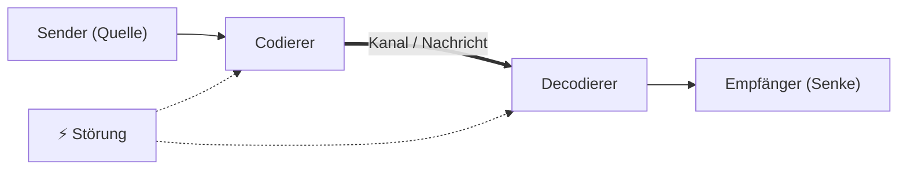

# Definitionen
## Definition Nachricht
**=> Eine Nachricht ist eine Folge von Zeichen, die von einem Sender in irgendeiner Form an einen Empfänger übertragen werden.**
- Zeichen stammen immer aus einem *Alphabet*.
- Zeichenfolge ist *abzählbar*, aber *nicht immer endlich*.
- Dadurch können Zeichen identifiziert werden.

## Definition Alphabet
Besteht aus:
- Einer *abzählbaren* Menge von Zeichen.
- Einer *Ordnungsrelation* der Zeichen.
- Menge ist oft *endlich*, kann aber auch *unendlich* sein.
- Ordnungsrelation definiert Reihenfolge der Zeichen.
# Nachrichtenraum
-  *Menge* aller Nachrichten, die mit den Zeichen eines *Alphabets* $A$ gebildet werden können, heißt $\text{Nachrichtenraum } N(A)$ über $A$.
- Wird auch als $A^*$ dargestellt.
- Betrachtet man nur Nachrichten einer *maximalen Länge* $s$, wird der Nachrichtenraum als $A_{s}$ dargestellt.
# Information
Sender *übersetzt* Information in Nachricht
=> Empfänger muss Information aus empfangener Nachricht *extrahieren*.
=> Setzt eine *Zuordnung* von Informationen voraus: *Interpretation*.
## Interpretation
- Keine Abbildung im mathematischen Sinne.
- *Nicht* unbedingt *eindeutig*.
- Subjektiv und abhängig vom *Kontext*:
- *Interpretationsvorschrift* muss nicht öffentlich sein.
## Informationsgehalt
- Statistisch in Bezug auf Nachricht aus $A^*$.
- *Informationstheorie* nach *Shannon*:
	- Je *seltener* ein Zeichen $x$ auftritt, desto *größer* soll sein Informationsgehalt sein:
		- $P(x)=\text{Eintrittswahrscheinlichkeit}$
		- $I(x) = \text{Informationsgehalt} = \frac{1}{P(x)}$
		- $P(x_{1},x_{2}) = P(x_{1}) \cdot P(x_{2}) \land I(x_{1},x_{2}) = I(x_{1}) + I(x_{2})$ *???*
		- $P(x)=1 \implies I(x)=0$
		- $I(x)$ wird nur als *Logarithmusfunktion* erfüllt.
		- $I(x)=\log_{b}\left( \frac{1}{P(x)} \right) = -\log_{b}(P(x))$
### Informationsgehalt in binären Systemen
- $A = {0, 1} \to b = 2$
- $I(x) = -\log_{b}(P(x)) = -\log_{2}(P(x)) = -ld(P(x))$ *???*
- Angenommen $P(x_{1})=P(x_{2})$ für alle $x_{1},x_{2} \in A^s$
	- $P(x) = 1 : 2^s$
	- $I(x) = -ld(1 : 2^s) = ld 2^s = s$
	- => Informationsgehalt ist *Länge* von *Binärzahlen*.
- Informationsgehalt von Zeichen *a-z* in der deutschen Sprache:
	- $P(\text{"e"}) = 0,174 \implies I(\text{"e"}) = ld(1 : 0,0252) = 2,52 \text{ Bit}$
	- $P(\text{"m"}) = 0,0252 \implies I(\text{"m"}) = ld(1 : 0,0252) = 5,31 \text{ Bit}$
	- $P(\text{"q"}) = 0,002 \implies I(\text{"q"}) = ld(1 : 0,02) = 8,96 Bit$
### Informationsgehalt von Nachrichten
- Entropie als "mittlerer" Informationsgehalt einer Nachricht $N$.
	- $H(N) = \text{Summe aller } P(x) \cdot I(x)$ für $x \in \text{ dom }N$
	- => $\text{dom } N$ ist die Menge aller in $N$ auftretenden Zeichen aus $A$.
	- Begriff *"Entropie"* => Entspricht *"Entropie"* aus Thermodynamik.
- $H(N)$ wird maximal, wenn $P(x_{1}) = P(x_{2})$ für alle $x_{1}, x_{2} \in \text{ dom } N$.
- Je kleiner $H(N)$, desto vorhersagbarer ist $N$.
- Offen, aber lösbar: *Korrelation* von Zeichen aus $A$.
# Codierung
- **Ziel:** Eine angemessene Darstellung von Nachrichten:
	- Möglichst wenig Zeichen.
	- Unempfindlich gegenüber Störungen.
	- Leicht zu verarbeiten.
- *Annahme:* endliche Alphabete.
- *Ablauf:*
	- Nachrichtenraum $A^*$ gegeben: $(a_{1},a_{2},\dots,a_{n})$.
	- Gegeben $B^*$ mit $B = (b_{1},b_{2},\dots,b_{m})$.
	- Gesucht wird umkehrbare Abbildung: $f: A^* \to C \subseteq B^*$.
	- => Damit ist $C$ dem Problem angemessen.
	- $C$ = Codierung von $A^*$.
- Für uns interessant: $C \subseteq \{0,1\}$, d.h. *Binärcodierung*.
## Wortlänge & Redundanz
- *Wortlänge* $L$ ist die Summe $p(w) \cdot |w|$, für alle $w \in C$.
	- $p(w)$ Auftrittswahrscheinlichkeit von $w$.
	- $|w|$ Länge von $w$.
- *Code-Redundanz* $R$ ist $L - H$.
	- $H$ ist die Entropie von $C$, $H \leq L$.
## BCD-Codierung
- *"Binary Coded Decimal"*.
- Neun Ziffern => 4 Bit.
- I/O einfacher, weniger Fehler => Finanz-mathematische Anwendungen.
- Abwandlung: Stibitz-Code: BCD+3, Neunerkomplement durch Invertierung.

| **Dez** | **BCD** | **Stibitz** | **Dez** | **BCD** | **Stibitz** |
| ------- | ------- | ----------- | ------- | ------- | ----------- |
| 0       | 0000    | 0011        | 5       | 0101    | 1000        |
| 1       | 0001    | 0100        | 6       | 0110    | 1001        |
| 2       | 0010    | 0101        | 7       | 0111    | 1010        |
| 3       | 0011    | 0110        | 8       | 1000    | 1011        |
| 4       | 0100    | 0111        | 9       | 1001    | 1100        |
- Bitsequenzen $1010$, $1011$, $1100$, $1101$, $1110$, $1111$ werden nicht vergeben.
- Beispiel BCD: $1097_{dez} = 0001000010010111 = 1097_{hex}$
- 