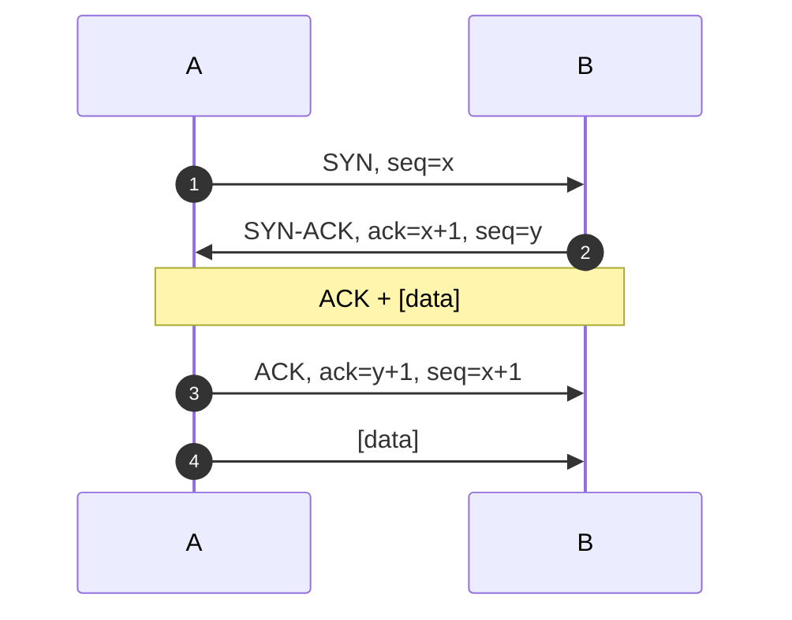

# Übertragungsmedium
- *Kabelgebunden:* Seriell, parallel, Bus, Punkt-zu-Punkt.
- *Funk:* WLAN, Bluetooth, NFC, Telefonie.
- *Licht:* Glasfaser, Infrarot.
- Ton oder physischer Transport von Daten.
# Charakteristiken
- Datenvolumen, Bandbreite, Übertragungsrate, Latenz.
- Echtzeit, Synchron, Asynchron, Reichweite.
- *Simplex* (Einweg), *Halbduplex* (Mehrweg, aber nicht gleichzeitig), *Vollduplex* (Mehrweg, gleichzeitig), *Dual Simplex* (zwei Simplex Leitungen).
# Begriffe
## Rechnernetz
=> Ein Rechnernetz ist eine *Menge von Knoten*, die jeweils über *ein oder mehrere Übertragungsmedium* kommunizieren können.
## Übertragungsmedium & Kanal
- Medium enthält einen oder mehrere Kanäle.
- Pro Kanal können *unabhängige* Nachrichten übertragen werden.
- *Multiplexing:* Nutzung eines Kanals durch mehrere Teilnehmer.
- Kanal besitzt Übertragungsrate (Bit/s).
## Übertragungsrate VS Bandbreite
- *Bandbreite* kommt aus analoger Signalverarbeitung.
	- Wird häufig in Hz gemessen.
- *Übertragungsrate* meist übertragene Daten in Bits/s.
## Reichweite & Latenz
- Signale werden mit zunehmender Entfernung schwächer => Störungen nehmen zu.
- Lichtgeschwindigkeit begrenzt Nachrichten: Benötigen *Mindestlaufzeit*.
- Zwischenknoten *verzögern* Mindestlaufzeiten.
- *Laufzeit* äquivalent zu *Latenz*.
## Protokoll
- Regelung der Kommunikation:
	- Wer darf wann was wie senden?
	- Wer muss wann wie auf eine empfange Nachricht reagieren?
=> Ein Kommunikationsprotokoll ist eine Menge von *Regeln*, welche die *Syntax*, die *Semantik*, die *Pragmatik* und die *Synchronisation* der Kommunikation bestimmt.
- *Syntax:* Beschreibt den Aufbau von Nachrichten.
- *Semantik:* Beschreibt die Bedeutung von Nachrichten.
- *Pragmatik:* Beschreibt die Einsatzszenarien von Nachrichten.
- *Synchronisation:* Beschreibt das zeitliche Verhalten bei der Übertragung von Nachrichten.
# ISO/OSI Referenzmodell
- Modell zur Datenkommunikation in offenen Systemen.
- *ISO-Norm 7498* für *Open System Interconnection* (OSI).
- *Ziel:* Kommunikation über unterschiedlichste technische Systeme hinweg zum beschreiben.
- Sieben logische Schichten:
	- Jede Schicht stellt *Dienste* für *bestimmte Aufgaben* zur Verfügung.
	- Schicht $N$ unterstützt Schicht $N+1$.
	- Schicht $N$ nutzt Schicht $N-1$.
- Nicht jede Schicht muss in jeder Anwendung verwendet werden.
## Schichten
1. *Physical Layer (Bitübertragungsschicht):* Codierung und Übermittlung von Bitströmen.
2. *Link Layer (Sicherungsschicht):* Steuerung Datenübertragung, Fehlererkennung.
3. *Network Layer (Netzwerkschicht):* Routing von Datenpaketen.
4. *Transport Layer (Transportschicht):* End-zu-End Steuerung.
5. *Session Layer (Sitzungsschicht):* (Prozess-) Synchronisation.
6. *Presentation Layer (Darstellungsschicht):* Übersetzung von Datenformaten.
7. *Application Layer (Anwendungsschicht):* allg. Dienste, Anwendungen, Netzwerkmanagement.
## Protokolle & Mehr
- Für jede Schicht wurden *eigene Protokolle* und sonstige Datenformate spezifiziert und standardisiert.
- Standardisierung durch *Internationale Fernmeldeunion* (ITU).
## Arpanet & Nachfolger
- *Separate Aktivität* für ein *dezentrales Computernetz* (ab 1968).
	- Advanced Research Projects Agency Network.
	- *Konzept:* Paketevermittlung, Routing.
- *Ab 1971:* E-Mail, Telnet, FTP, TCP.
- *1981:* Spezifikation von IPv4, ICMP (Management), TCP.
- Implementierung in UNIX/C.
- Nutzung an Hochschulen -> *Usenet*.
## ISO/OSI Modell Heute
- Modell hat sich *nicht* technisch durchgesetzt.
- TCP/IP war schon implementiert.
## Referenzmodell
- Nutzung als *Modell*, um andere Modelle zu vergleichen.
- Aufteilung in Schichten ist meist sinnvoll.
- Entkopplung von Komponenten (-> *Softwaretechnik*).
- Half, Internetprotokolle in die Welt der ITU zu integrieren.
	- Kommunikationsnetze auf *Schicht 1* gehören meist *Telekommunikationsunternehmen*.
## Bitübertragungsschicht
- Zugang zum Übertragungsmedium.
### Übertragungsmedium
- *Twisted Pair:* Zwei oder mehr verdrillte isolierte Kupferadern.
- *Koaxial Kabel:* Eine Ader in der Mittel, Isolator, leitende Abschirmung.
- *Lichtwellenleiter:* Glasfaser, Laserdiode als Sender, Photodiode als Empfänger.
- *Funk im freien Raum:* Signal wird auf Trägerfrequenz moduliert.
	- Amplitude-, Frequenz-, Phasenmodulation.
- Modulation funktioniert auch bei Twisted Pair und Koaxial Kabel.
### Leitungscodierung
- Wie soll $\{0,1\}$ über eine Leitung übertragen werden.
- *Idee:* 1 = High-Pegel = 3 V; 0 = Low Pegel = -3 V.

![[Pasted image 20261105100010.png|521]]
### Multiplexing
- Gemeinsamer Nutzung eines Übertragungsmedium.
	- *Raummultiplex:* (eigentlich Kanäle) -> MIMO bei WLAN.
	- *Zeitmultiplex:* Aufteilung in exklusive, disjunkte Zeitintervalle.
	- *Frequenzmultiplex:* Nutzung unterschiedlicher Frequenz.
	- *Codemultiplex:* Nutzung von Alphabet mit Länge $2^n$ statt Binärcode.
### Netztopologien
- Kanäle werden über *Knoten* zu *Netzen* zusammengeschalten.
- *Liniennetze* sind häufig Busse, Leitungsausfall problematisch.
- *Ringnetze* eher auf regionaler, globaler Ebene.
- *Stern-* und *Baumstruktur* besitzen zentrale Knoten (z.B. Home-Router).
- Vermaschte Netze für Hohe Ausfallsicherheit.
## Sicherungsschicht
- *Steuerung* & *Überwachung* der Datenübertragung auf Abschnitte zwischen Knoten des Netzes.
- Knoten müssen sich *gegenseitig direkt* über ein Übertragungsmedium erreichen können.
- Wer darf auf das gemeinsame Übertragungsmedium zugreifen?
	- *Teilschichten:* Media Access Control (MAC) & Linkt Control (LLC).
-> Abhängig von der Größe des Netzes, d.h. *Knotenabstand*.
### Nahbereich: PAN & WPAN
- *(Wireless) Personal Area Network.*
- *Bluetooth:* Bis 10 m, preiswerte Hardware, geringer Stromverbrauch, Multimediadaten, Master-Slave.
- *Bluetooth Low Energy:* 40-200 m, geringerer Stromverbrauch, 1-2 MBit/s.
- *Radion Frequency Identification (RFID):* Sendet nur eine Identifikation (Ursprung), Freund/Feind-Erkennung.
- *Near Field Communication (NFC):* 10 cm, bis ca 400 KiBits/s.
### Lokaler Bereich: LAN & WLAN.
- *(Wireless) Local Area Network.*
- *Ethernet:*
	- Datenpakete mit 64 bis ca. 1500 Byte.
	- *Ursprünglich* Bussystem mit 10 MBit/s und Koaxial-Kabel.
	- *Heute:* > 10 GBit/s & Twisted Pair in Stern Topologie (Switch, Hub).
- *WLAN / WiFi:*
	- Datenfunk, Frequenzband 2.6 GHz, 5 GHz, 6 GHz.
	- *Access Point* (AP) als spezieller Router.
	- Kommunikation *verschlüsselt*.
### Zugriff auf gemeinsame Mediem
- CMSA-Verfahren: *Carrier Sense*, *Multiple Access*.
#### CSMA/CD
- *Collision Detection.*
- *CS* => Hören, ob Medium frei ist.
- *CD* => Kollisionserkennung bei mehreren Sendern.
- Nur *Vollduplex*.
#### CSMA/CA
- *Collision Avoidance.*
- *CS* => Hören, ob Medium frei ist.
- *CA* => Wenn Medium nicht frei => Zufallszeit warten, hören => Senden.
- Funkt meistens *Halbduplex*.
### Regionalbereich: Internetzugang
- *Analoge Telefonverbindung* (Audiomodulation, 56.6 KBit/s); ISDN (128 KBit/s -> 2 MBit/s).
- *Digital Subscribe Line (DSL):* Telefonleitung mit 1-35 MHz Bandbreite.
- *Kabelanschluss:* grob DSL über Fernsehkabel.
- *Glasfaser:* Backbone-Technologie zu Hause.
- *Mobil:* 2G (Analogtelefon), 3G (IP-basiert), LTE (4G), 5G (modernes WLAN mit MIMO).
- Satelitteninternet: Richtfunk.
- Gemeinsames Zugangsprotokoll: PPP "simuliert" Ethernet Pakete mit MAC-Addressen.
### Global: WAN
- *Wide Area Network.*
- *Glasfaserbündel*, hochwertige Lichtwellenleiter.
- *Geostationäre Satelliten*, breitbandiger Richtfunk.
- Datenübertragungsraten > 1 TBit/s.
## Netzwerkschicht
- *Übermittlung* von Datenpaketen zwischen *zwei* beliebigen, *indirekt* verbundenen, Knoten.
- Jedes Datenpaket kann *eigene* Route haben.
- "End-zu-End" zwischen Knoten.
- Auch: Vermittlungsschicht.
### Weitervermittlung
- Wie können Nachrichten zwischen *mehreren* Netzen übertragen werden?
- *Lösungsansatz:*
	- Knoten bekommen global *eindeutige* Adressen.
	- Nachrichten werden in *endliche* Datenpakete aufgeteilt.
	- Pakete werden *unabhängig* in Richtung Zieladresse weitergeleitet.
- Paket soll einen Weg (Route) zum Ziel nehmen.
- Knoten können *mehrere* Adressen haben, wenn sie mit mehreren lokalen Netzen verbunden sind.
=> Lokales Netz bezieht sich *nicht* auf LAN oder WLAN der Sicherungsschicht. Es ist ein Begriff in der Sprache der *Netzwerk-/Vermittlungsschicht* und bezeichnet *alle* Netze der Sicherungsschicht.
### Datenpaket
- Nachricht mit *beschränkter* Länge (Praxis: *1500 Bytes*, aber auch mehr in Glasfaser oder Jumbo Frames).
- Enthält die *eigentliche Nachricht*.
- Enthält *Sender-* und *Empfängeradressen*.
- Enthält *Verwaltungsdaten*, z.B. wie lange es unterwegs ist.
- Netzwerkschicht teilt *zu große* Pakete auf und fasst zusammengehörige kleine Pakete *zusammen*.
### Ermittlung des Paketwegs
- Jeder Knoten besitzt eine Tabelle, auf der Ziele und mögliche Wege verzeichnet sind: *Routingtabelle*.
- Arten von *Tabelleneinträgen*:
	- *Direkt verbundene Netze:* alle Knoten im gleichen lokalen Netz.
	- *Statische Wege:* Vom Administrator vorgegeben, um bestimmte Wege zu erzwingen.
	- *Dynamisch ermittelte Wege:* Informationen über weiter entfernte Knoten.
### Netzwerkschnittstelle
- Ein Knoten kann in *mehr* als einem lokalen Netz liegen.
	- Pro Netzwerk ein *eigener* Zugang.
	- Netzwerkadresse bezieht sich nicht auf Knoten, sondern auf *Netzwerkschnittstelle*.
- *Zwei* Netzwerkschnittstellen können im *gleichen* lokalen Netz liegen.
	- Sinnvoll, z.B. bei WAN: Zwei Computer sind durch *unterschiedlich* verlaufende *Lichtwellenleiter* verbunden.
### Routingalgorithmen
- Zur Ermittlung der *Routingtabelle*.
- Im *"Backbone"* besonders relevant.
	- Backbone verknüpft *lokale Netze* (selbst ein lokales Netz).
	- Bei *Internet Providern*, WAN, MAN, etc.
- Datenpaket hat Feld "Time To Live".
- *Beispielalgorithmen:*
	- Flooding/Broadcasting, Hot Potato.
	- Backward Learning.
	- Link-State Routing.
### Netzwerkschicht im Internet
- *Internet Protocol* (IP).
- Adressen:
	- *IPv4:* 32 Bit, d.h. $2^{32} \approx 4.3 \cdot 10^9$ Adressen.
	- *IPv6:* 128 Bit, d.h. $2^{128} \approx 3.4 \cdot 10^{38}$ Adressen.
- *Spezielle Adressen*, z.B. für eigene Rechner.
- Reservierte IPv4-Adressen für private Netze.
	- *192.168..0.0* bis *192.168.255.255*.
	- *Network Address Translation* (NAT) als Notlösung für IPv4.
- Adresszuweisung *statisch* oder *dynamisch*.
## Transportschicht
- Aufbau von *logischen* Verbindungen zwischen zwei Anwendungen.
- Datenpakete in einen Datenstrom umwandeln -> *Paketreihenfolge*.
	- ggf. verlorene Pakete nachsenden, doppelt empfangene Pakete ignorieren.
- Sicherstellung der Dienstgüter (*Quality of Service*).
	- Angleichung: *Sende-* und *Empfangsraten*.
- *"End-zu-End"* zwischen zwei Anwendungen.
### Logische Verbindungen
- Einer der Partner *initiiert* Verbindungsaufbau.
- Der andere Partner wartet auf *Wünsche* zum Verbindungsaufbau.
### Verbindungsaufbau
- *Wichtig:* Datenpakete können verloren gehen.
- Ablauf (*Three Way Handshake*):
	1. *A* sendet *B* Datenpaket zum Aufbauwunsch.
	2. *B* sendet *A* Bestätigung des Wunsches.
	3. *A* sendet *B* Quitting.
- Was kann passieren?
	- *Erstes* Paket geht *verloren* -> A wartet und *wiederholt*.
	- *Zweites* Paket geht *verloren* -> A wartet und wiederholt, B *ignoriert* und bestätigt erneut.
	- *Drittes* Paket geht *verloren* -> B wartet und *wiederholt*, A *ignoriert* dies.
- Weitere Probleme:
	- *C* sendet Pakete im Namen von *A* oder *B* -> Sequenznumern.
	- *A* ist böse und antwortet nach dem ersten Paket nicht mehr -> *SYN Flooding*.
- Verbesserung: Mit dem *dritten* Paket kann *A* schon Daten senden.

### Paketreihenfolge
- Routing kann bewirken, dass Datenpakete in *unterschiedlicher* Reihenfolge ankommen.
- Jedes Paket bekommt *Sequenznummer*.
### Doppelte Pakete
- Empfänger *merkt sich*, welche Sequenznummern schon empfangen wurden.
- Trifft Paket mit empfangener Nummer ein -> *ignorieren*.
- Nicht trivial umzusetzen, wenn Anzahl Nummern sehr *begrenzt* ist.
### Verlorene Pakete
- *Fehlende* Sequenznummer, wie bei falscher Reihenfolge.