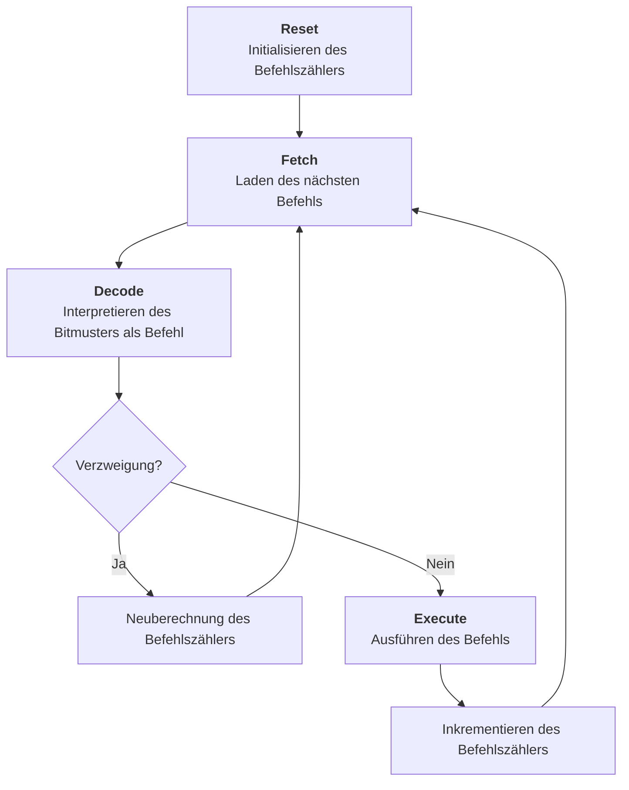
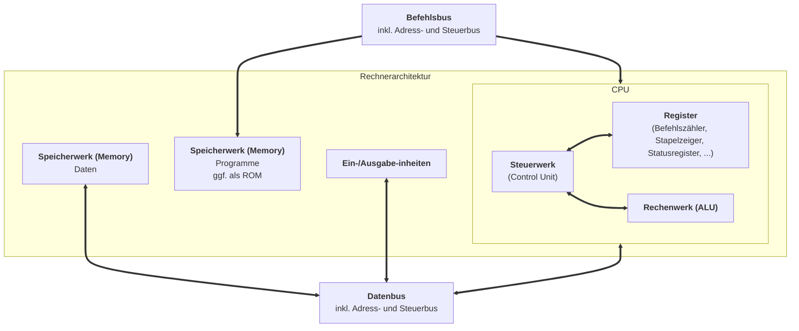
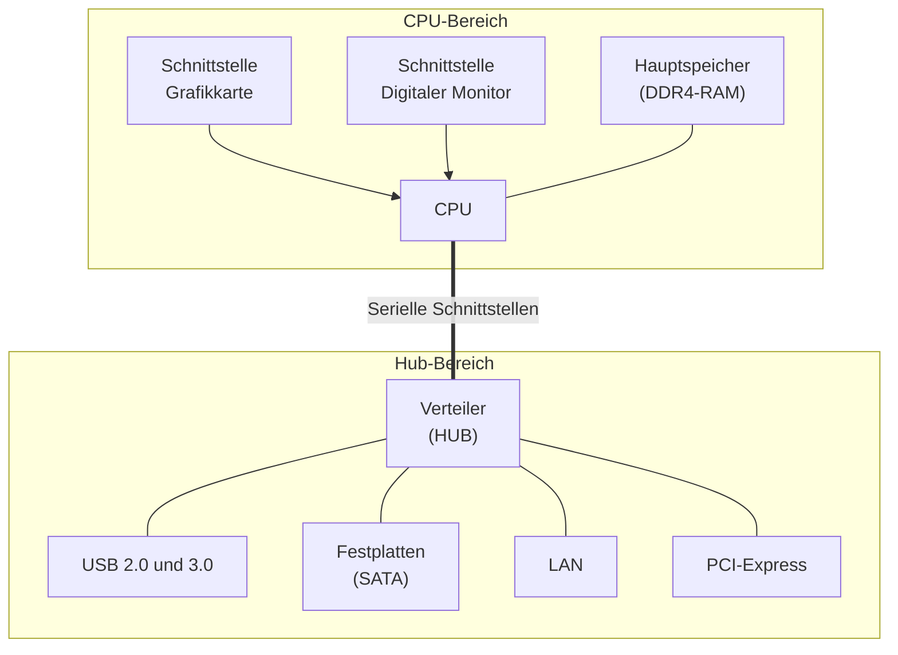
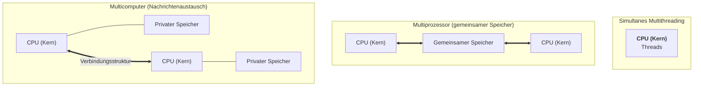

# Ebenen
- **Physikalisch:** Silikon; Wafer.
- **Digitale Schaltung:** Transistoren; Kondensatoren; Schaltwerke.
- **Mikroarchitektur:** Rechenwerk; Steuerwerk; Register.
- **Befehlssatz:** CISC; RISC; armv7; i386; i686.
- **Computer & Cluster:** Speicher; I/O; CPU; Netzwerke.
# Von Neumann Architektur
## Steuerwerk
- Zentrale *Kontrolle* über CPU.
- Liest Befehle *seqientiell* aus dem Speicher.
- Delegation an Rechenwerk bzw. I/O-Einheit.
## Rechenwerk
- *ALU* - Arithmetic Logic Unit.
- Führt arithmetische und logische Berechnungen durch.
- Typisch: Zwei *Eingangsregister*, ein *Ausgangsregister*, ein *Statusregister*.
- Meist: *Akkumulator* als Register für einen Operanden und das Ergebnis.
- Ein-Address-Maschine: *Ein* Akkumulator, häufiges Zwischenspeichern nötig.
- Zwei-Address-Maschine: *Viele* Akkumulatoren.
- Drei-Adress-Maschine: Eingang und Ausgang *beliebig*.
## Speicherwerk
- Enthält Befehle in Maschinensprache.
- Dauerhaft speicherte Befehle im *ROM*.
	- *EEPROM* - Electrically Erasable Programmable Read Only Memory.
- Daten meist im *RAM* (Rand-Access-Memory).
- Daten und Befehle werden gleich behandelt.
## Ein- und Ausgabeeinheiten
- Datenaustausch und Peripheriegeräte.
	- Tastatur, Maus, Display, Drucker, Netzwerk, externe Speicher.
- Meist *langsam*, häufig auch eigener Prozess mit *DMA*.
## Operationsprinzip
- Kleinste Dateneinheit: *Wort*, ein beliebiges Bitmuster definierter Länge. Kann kodieren:
	- Einen Maschinenbefehl.
	- Ein Datum / Wert zum Verarbeiten.
	- Adresse eines Speicherplatzes.
- Bedeutung des Wortes abhängig vom *Kontext*.
## Befahlsbearbeitung

## Beobachtung
- *Gemeinsamer* Speicher für Daten und Programm.
- Daten sind Programme sind Daten.
- Serielle Abarbeitung von Befehlen.
# Harvard Architektur

# Desktop Architektur

## CPU
- Häufig: *"amd64",* d.h. Intel 4004 -> 8008 -> 8080 -> 8086 -> 80386 -> AMD Operation.
- Aufstrebend: *"ARM"* -> "Acorn RISC Machines" -> "Advanced RISC Machines".
	- Apple M1-M6; Qualcomm.
	- RISC.
	- Keine eigene Fertigung, nur Lizenzen.
- Taktraten *1-6 GHz*
	- Ab ca. *3 GHz* steigt Stromverbrauch signifikant an.
- Unterschiedliche CPU-Kerne.
	- Performance Kerne.
	- Effizienz Kerne.
- Co-Rechenkerne für "KI-Anwendungen".
## Hauptspeicher
- *DDR-SDRAM* - Double Data Rate Synchronous Dynamic Random Access Memory.
	- DDR3; DDR4; DDR5.
- Meist 8-32 GiB.
- Latenzzeit DDR5 typisch *30ns*.
## Grafikkarte
- Einfache Berechnungen, massiv *parallel*.
- Eigener *Grafikchip*: Graphics Processing Unit.
- Hoher Stromverbrauch.
- Teilweise mit CPU auf einen Chip integriert.
## Sekundärspeicher
- Festplatte; SSD.
- Wegen Durchsatzmaximierung direkt Angeschlossen (SATA; PCIe; ...).
- *Große Festplatte:* > 4 TB; Latenz ca. 2-5 ms; Durchsatz: 150 MB/s; Preis 25€/TB -> 150€/TB.
- *Große SSD:* 512 GB - 4 TB; Latenz ca. 250 us; Durchsatz 500 MB/s; Preis 70€/TB -> 150€/TB.
## Sonstige Peripherie
- Maus; Tastatur; Monitor; Mikrofon; Kamera; Scanner; Audio; LAN; WLAN.
- USB, HDMI, DisplayPort; Thunderbolt; etc.
# Klassifikation nach Flynn
## Single Instruction Single Data
- Jeweils *ein* Befehls- und Datenstrom.
- Von Neumann Architektur.
- Verbesserungen:
	- 64 Bit Wortbreite, d.h. Verarbeitung von 8 Byte pro Befehl.
	- *Pipelining:* Aufteilung von Befehlen, die mit Hilfe eines Fließbands ausgeführt werden.
	- *Skalar (mit Pipelining):* Pro Takt einen Befehl starten.
	- *Super-Skalar:* Mehr als einen Befehl pro Task starten & ausführen.
- *Probleme:* Insbesondere bedingte Sprünge leeren die Pipeline.
## Single Instruction Multiple Data
- *Ein Befehlsstrom*; *Viele Datenströme*, auf denen Befehle gleichzeitig angewendet werden.
- *Array-* und *Vektorrechner*.
## Multiple Instruction Single Data
- Nur für *Spezialstanwendungen*.
- Datum wird x-Mal gelesen, die Kopien anders bearbeitet und das Ergebnis zusammengefügt.
- Datum eher klein: binärlogische Operationen -> direkt in Hardware realisieren.
- Datum eher sehr groß -> passen selten in CPU.
## Multiple Instruction Multiple Data
- *Viele Datenströme* werden durch *viele Befehlsströme* verarbeitet.
- Multithreading:
	- Thread = Befehlsstrom.
	- Mehrere Steuer- und Rechenwerksteile in einem CPU-Kern.
	- Teilen sich ggf. aufwendige Rechenwerke, z.B. Gleitkommaberechnung.
# Parallelität im CPU
## Pipelining
- Aktivitäten/Takten zur Ausführung von Befehlen (RISC):
	1. Befehl aus dem Speicher holen, *Befehlszähler* erhöhen.
	2. Befehl *dekodieren*, relevante Operanden laden.
	3. Befehl *ausführen*.
	4. *Speicherzugriff:* Lesen & Schreiben.
	5. *Ergebnis* in Register schreiben, ggf. in Hauptspeicher.
- *Ohne Pipeline:* 5 Takte pro Befehl.
- *Mit Pipeline:* Ein Befehl pro Takt (ideal).
- Probleme:
	- *Steuerkonflikte*, insbesondere bedingte Sprünge.
		- Mit der Ausführung begonnene Befehle können *nicht abgebrochen* werden.
		- *Pseudo-Lösung:* Sprungvorhersage, spekulative Ausführung.
	- *Datenkonflikte:*
		- Datum wird vom ersten Befehl berechnet (Ende Takt 3), aber vom nächsten Befehl schon in Takt 2 benötigt.
		- *Pseudo-Lösung:* Vorziehen anderer Befehle.
	- *Strukturkonflikte:*
		- Gleichzeitiger Zugriff auf Speicher.
	- *Teil-Lösung:* Pipeline verlängern.
## Very Long Instruction Word
- Unterbringen *mehrerer* Befehle in *einem* Speicherwort.
- Parallelisierung/Konfliktlösung durch Erstellen des Maschinencodes auf höherer Ebene.
- Beispiel:
	- 128 Bit: $3 \cdot 41$ Bit für Befehlscodes, 5 Bit für Sonderfälle.
	- Speicherwort wird gelesen und dann an drei Einheiten zum *Dekodieren*, *Ausführen*, *Speichern* & *Schreiben* weitergegeben.
- Probleme:
	- *Begrenzte Parallelität.*
	- Wenn keine Parallelität möglich: *87 Bit verschwendet*.
	- *Strukturkonflikt*, z.B. Hauptspeicher (Lösung: Pipelining).
## Vektorprozessoren
- Parallelität in Daten ausnutzen: *SIMD*.
- Früher: Spezielle Computer, etwa für Wettervorhersage.
- Heute: *MMX-*, *SSE-*, *AVX-*Erweiterungen bei amd64.
	- Bis zu 32 Register mit je bis zu 512 Bit, 3-Address.
- Heute: *NPU*, mit grob 20.000 Recheneinheiten.
## Mehrere Befehlssequenzen
- Etwa 2003 ist Taktrate an physikalische Grenze gestoßen.
	- CPU sehr viel *schneller als Hauptspeicher*, d.h. Daten können nicht schnell genug geladen werden.
	- Ab ca. 3 GHz steigt Stromverbrauch stark an.
	- *Lösung:* Erhöhung der Parallelität:
	- *Varianten:*
		- Simultanes Multithreading.
		- Multiprozessor.
			- Genügend viele CPU-Kerne.
			- *Eigene* Steuer- und Rechenwerke.
			- Kommunikation über *gemeinsamen* Speicher.
		- Multicomputer.

### Probleme
- Zwei Prozessoren schreiben/lesen gleichen Speicher:
	- *Synchronisation* nötig.
	- Zugriffsgeschwindigkeit sinkt.
- *Endliche Bandbreite* des Bussystems.
	- Beschränkungen Anzahl CPU-Kerne.
- *Gleiche Taktrate* nötig.
	- Stromverbrauch.
	- Selbst unsynchronisierter Zugriff auf Speicher dauert länger.
## Non-Uniform-Memory-Access
- Prozessor erhält privaten Speicher.
- Je nach Speicher muss Prozessor anders arbeiten.