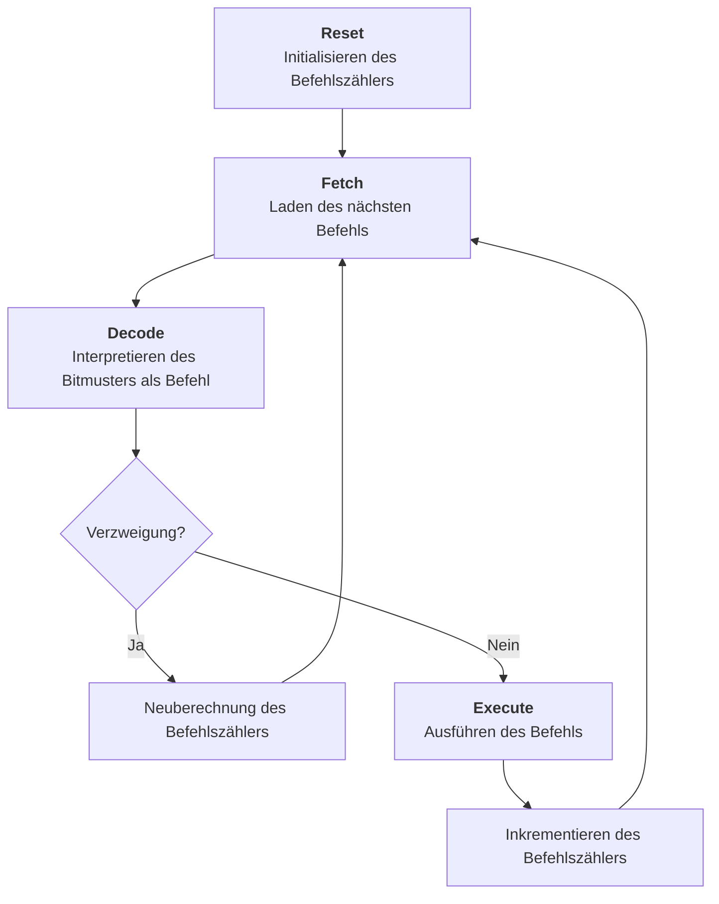
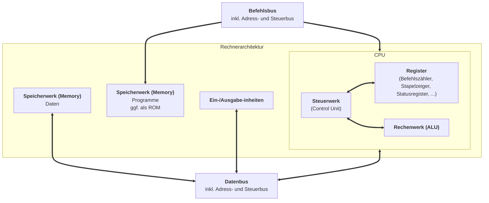
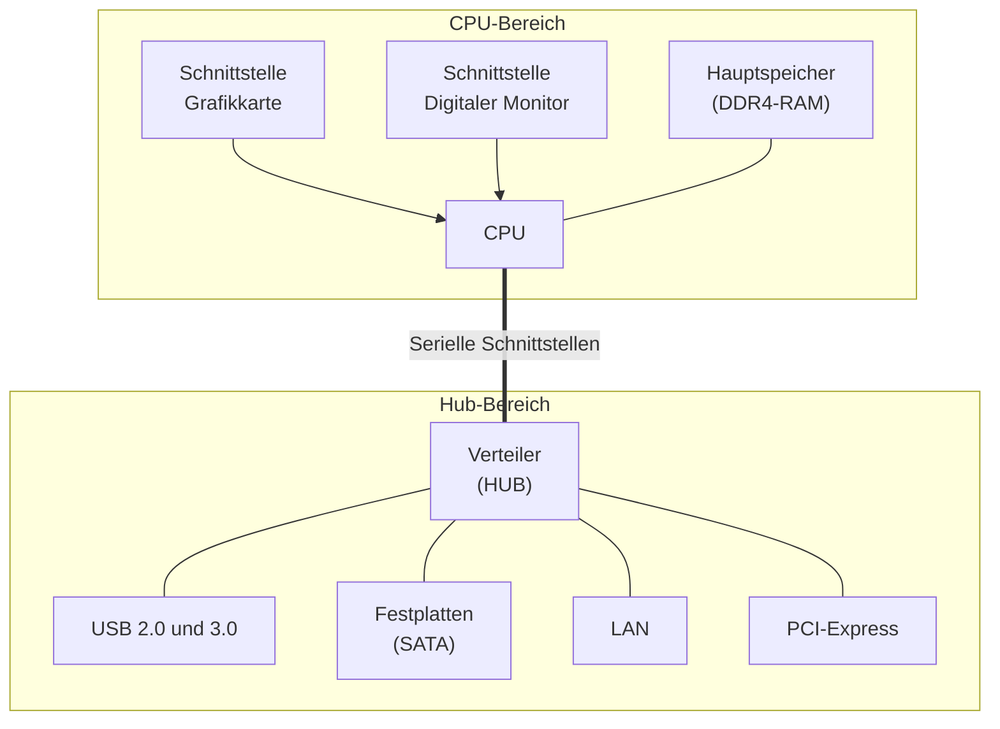

# Ebenen
- **Physikalisch:** Silikon; Wafer.
- **Digitale Schaltung:** Transistoren; Kondensatoren; Schaltwerke.
- **Mikroarchitektur:** Rechenwerk; Steuerwerk; Register.
- **Befehlssatz:** CISC; RISC; armv7; i386; i686.
- **Computer & Cluster:** Speicher; I/O; CPU; Netzwerke.
# Von Neumann Architektur
## Steuerwerk
- Zentrale *Kontrolle* über CPU.
- Liest Befehle *seqientiell* aus dem Speicher.
- Delegation an Rechenwerk bzw. I/O-Einheit.
## Rechenwerk
- *ALU* - Arithmetic Logic Unit.
- Führt arithmetische und logische Berechnungen durch.
- Typisch: Zwei *Eingangsregister*, ein *Ausgangsregister*, ein *Statusregister*.
- Meist: *Akkumulator* als Register für einen Operanden und das Ergebnis.
- Ein-Address-Maschine: *Ein* Akkumulator, häufiges Zwischenspeichern nötig.
- Zwei-Address-Maschine: *Viele* Akkumulatoren.
- Drei-Adress-Maschine: Eingang und Ausgang *beliebig*.
## Speicherwerk
- Enthält Befehle in Maschinensprache.
- Dauerhaft speicherte Befehle im *ROM*.
	- *EEPROM* - Electrically Erasable Programmable Read Only Memory.
- Daten meist im *RAM* (Rand-Access-Memory).
- Daten und Befehle werden gleich behandelt.
## Ein- und Ausgabeeinheiten
- Datenaustausch und Peripheriegeräte.
	- Tastatur, Maus, Display, Drucker, Netzwerk, externe Speicher.
- Meist *langsam*, häufig auch eigener Prozess mit *DMA*.
## Operationsprinzip
- Kleinste Dateneinheit: *Wort*, ein beliebiges Bitmuster definierter Länge. Kann kodieren:
	- Einen Maschinenbefehl.
	- Ein Datum / Wert zum Verarbeiten.
	- Adresse eines Speicherplatzes.
- Bedeutung des Wortes abhängig vom *Kontext*.
## Befahlsbearbeitung

## Beobachtung
- *Gemeinsamer* Speicher für Daten und Programm.
- Daten sind Programme sind Daten.
- Serielle Abarbeitung von Befehlen.
# Harvard Architektur

# Desktop Architektur

## CPU
- Häufig: *"amd64",* d.h. Intel 4004 -> 8008 -> 8080 -> 8086 -> 80386 -> AMD Operation.
- Aufstrebend: *"ARM"* -> "Acorn RISC Machines" -> "Advanced RISC Machines".
	- Apple M1-M6; Qualcomm.
	- RISC.
	- Keine eigene Fertigung, nur Lizenzen.
- Taktraten *1-6 GHz*
	- Ab ca. *3 GHz* steigt Stromverbrauch signifikant an.
- Unterschiedliche CPU-Kerne.
	- Performance Kerne.
	- Effizienz Kerne.
- Co-Rechenkerne für "KI-Anwendungen".
## Hauptspeicher
- *DDR-SDRAM* - Double Data Rate Synchronous Dynamic Random Access Memory.
	- DDR3; DDR4; DDR5.
- Meist 8-32 GiB.
- Latenzzeit DDR5 typisch *30ns*.
## Grafikkarte
- Einfache Berechnungen, massiv *parallel*.
- Eigener *Grafikchip*: Graphics Processing Unit.
- Hoher Stromverbrauch.
- Teilweise mit CPU auf einen Chip integriert.
## Sekundärspeicher
- Festplatte; SSD.
- Wegen Durchsatzmaximierung direkt Angeschlossen (SATA; PCIe; ...).
- Große Festplatt